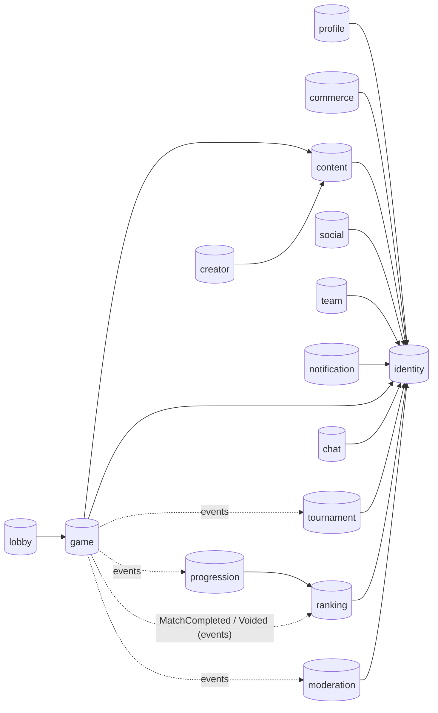
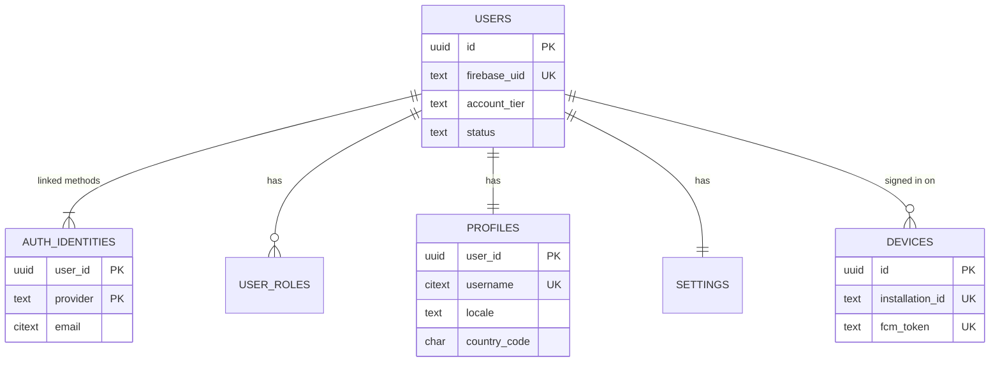
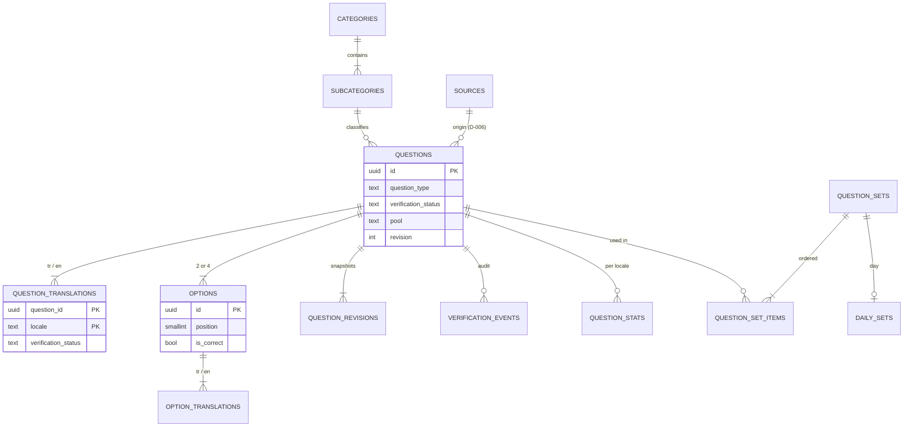
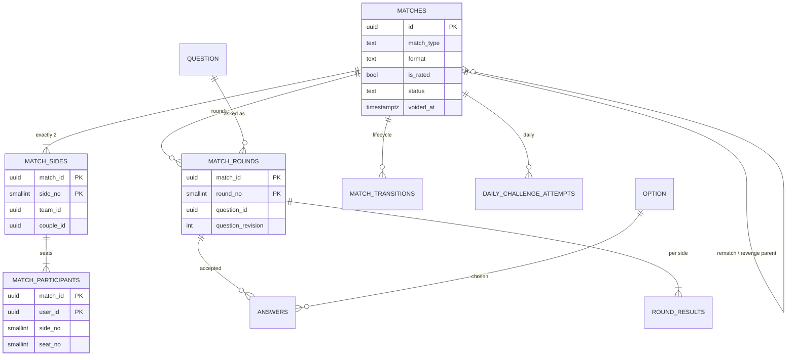
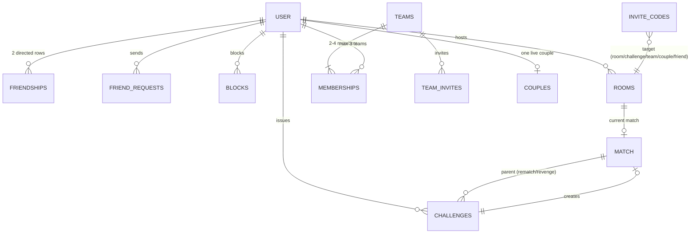
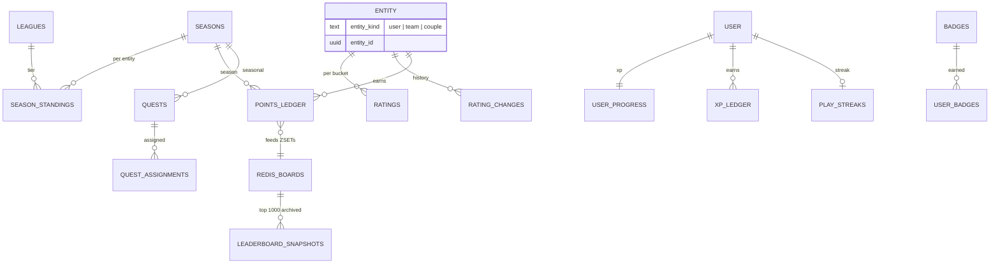
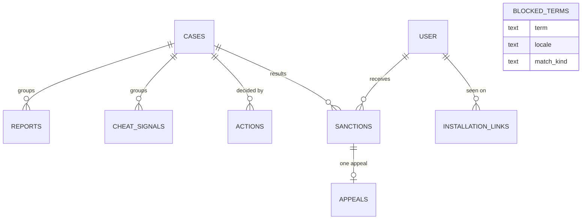
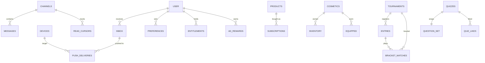

# Data model overview, ERD & review

- **Roadmap task:** 0.2.10
- **Status:** Accepted (2026-10-15)
- **Covers:** `schema-identity.md`, `schema-content.md`, `schema-game.md`, `schema-social.md`, `schema-ranking.md`, `schema-moderation.md`, `schema-platform.md`, `redis-keys.md`
- Diagrams use Mermaid (renders on GitHub). They show **keys and relationships only**; column details live in the schema documents.

---

## 1. Inventory

One PostgreSQL database, **15 schemas, 87 tables** (after the fixes in §4).

| Schema (module) | Tables | Doc |
|---|---:|---|
| identity | 3 | schema-identity |
| profile | 2 | schema-identity |
| notification | 5 | schema-identity §4, schema-platform §1 |
| content | 15 | schema-content |
| game | 8 | schema-game, schema-platform §6 |
| social | 3 | schema-social |
| lobby | 3 | schema-social |
| team | 4 | schema-social |
| ranking | 9 | schema-ranking |
| progression | 9 | schema-ranking |
| moderation | 8 | schema-moderation |
| chat | 3 | schema-platform §2 |
| tournament | 4 | schema-platform §3 |
| commerce | 9 | schema-platform §4 |
| creator | 2 | schema-platform §5 |

**Dependency check:** every cross-schema foreign key was extracted from the documents and compared with the allowed-import table in `backend-modules.md` §2. **All 56 cross-schema FKs follow allowed edges** (almost all point at `identity.users`; the others are game → content, lobby → game, creator → content, progression → ranking). References that would go *upward* are stored as plain ids by design (e.g. `game.matches.season_id`, `game.match_sides.team_id`, `ranking.*.match_id`).

---

## 2. Module-level map

Solid arrows = foreign keys. Dotted = outbox events (no FK).

---

## 3. Entity-relationship diagrams

### 3.1 Identity, profile, devices

### 3.2 Content

### 3.3 Game

### 3.4 Social, lobby, team

### 3.5 Ranking & progression

### 3.6 Moderation

### 3.7 Platform (notification, chat, tournament, commerce, creator)

---

## 4. Review findings (fixed in the schema documents as part of this task)

| # | Finding | Fix |
|---|---|---|
| F1 | `game.answers` references `content.options`; editing a used question could delete/replace options and break history, and `revision` alone did not record what text players saw. | Options become **immutable once a question has been used**; changing the correct answer = retire + new question. New table `content.question_revisions` stores a full snapshot per revision. (`schema-content.md` §2, §4.3) |
| F2 | The 12-month purge of answer detail (D-026) had no time column on `answers` and no index on round time. | `game.answers.created_at` added; index `match_rounds_revealed_idx`. Purge job deletes in batches by time; monthly partitioning can be added later without app changes. |
| F3 | `UNIQUE` constraints with a nullable column allowed duplicates (Postgres treats NULLs as distinct): `ranking.points_ledger` (overall row has NULL category) and `moderation.blocked_terms` (NULL locale). | Both use `UNIQUE NULLS NOT DISTINCT` (Postgres 15+; we run 18). |
| F4 | Missing indexes on frequent lookups: outgoing friend requests, sent challenges, a user's pending team invites, a user's subscriptions, a team's tournament entries. | Five partial/plain indexes added (`schema-social.md`, `schema-platform.md`). |
| F5 | `identity.users` is referenced by ~50 FKs, many without `ON DELETE`. | Confirmed by design: **user rows are never deleted**, only anonymised (`schema-identity.md` §6), so these FKs can never block a purge. Rule recorded here; no change. |

Checked and fine: every table has a primary key; every enum is a CHECK; every user-scoped list has an index starting with `user_id`; every event consumer table has an idempotency key (`rating_changes` PK, `points_ledger` unique, `xp_ledger` unique, `store_events` unique, `ad_rewards` unique).

---

## 5. Consolidated retention

| Data | Kept | Source |
|---|---|---|
| Users (anonymised after deletion), match results, sides, participants, rating changes, standings, leaderboard snapshots, verification history, question revisions, XP ledger, badges | **forever** | D-022, D-026 |
| Round, answer, round-result detail; match transitions & round event logs | **12 months** | D-026, D-033 |
| Abandoned guest (0 matches) / link-conflict guest / inactive guest | 7 days / 7 days / 90 days | D-022 |
| Account deletion | 14-day cooling-off, then purge | D-022 |
| Moderation cases, actions, sanctions, appeals | **3 years** (permanent bans while active) | D-030 |
| Report comments, cheat signals, installation links | **12 months** | D-030 |
| Chat messages | **6 months** | D-031 |
| Notification inbox; push delivery log | **30 days**; **30 days** | D-031 |
| Expired invite codes | deleted **30 days** after expiry | schema-social |
| Closed friend requests, challenges, rooms, team invites (non-pending) | **90 days** | D-033 |
| Quest assignments | **12 months** after period end | D-033 |
| Commerce subscriptions & store events | **10 years** (TTK / VUK bookkeeping rules) | D-033 |
| Redis keys | per TTLs in `redis-keys.md` | D-032 |

All purges run as idempotent River jobs in `cmd/worker`, in small batches, outside peak hours (03:00–06:00 Europe/Istanbul).

---

## 6. Personal-data inventory (KVKK / GDPR)

| Where | Personal data | On account deletion (D-022 purge) |
|---|---|---|
| `identity.auth_identities` | email, provider subject ids | deleted |
| `profile.profiles` | username, display name, country | anonymised |
| `profile.settings`, `notification.preferences`, `notification.quiet_hours` | preferences, UTC offset | deleted |
| `notification.devices` | installation id, FCM token | deleted |
| `notification.inbox` | message params (may contain names) | deleted |
| `chat.messages` | free text | body blanked, sender kept as anonymised id |
| `moderation.reports.comment`, `moderation.appeals.text` | free text | blanked |
| `moderation.installation_links` | installation id | kept until its 12-month retention (needed to enforce bans, D-030) |
| `creator.quizzes` | title/description authored by user | quiz unpublished, author shown as "Deleted user" |
| `commerce.*` | purchase records | kept (legal), linked only to anonymised id |
| Firebase Auth | credentials | Firebase user deleted |

No birth dates (D-020), no photos (D-021), no hardware identifiers, no precise location are stored anywhere.

---

## 7. Accepted proposals (D-033)
1. Closed friend requests, challenges, rooms and team invites deleted after **90 days**.
2. Quest assignments deleted **12 months** after their period ends.
3. Commerce records kept **10 years** (to be confirmed with an accountant for Turkish bookkeeping rules).
4. Match lifecycle transitions treated as match detail (12 months).
