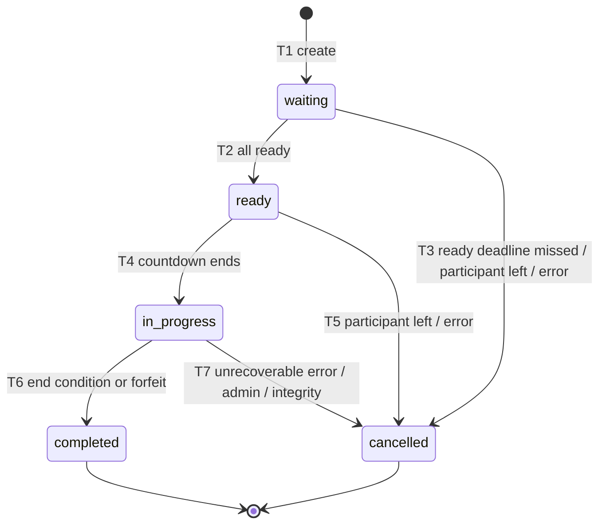
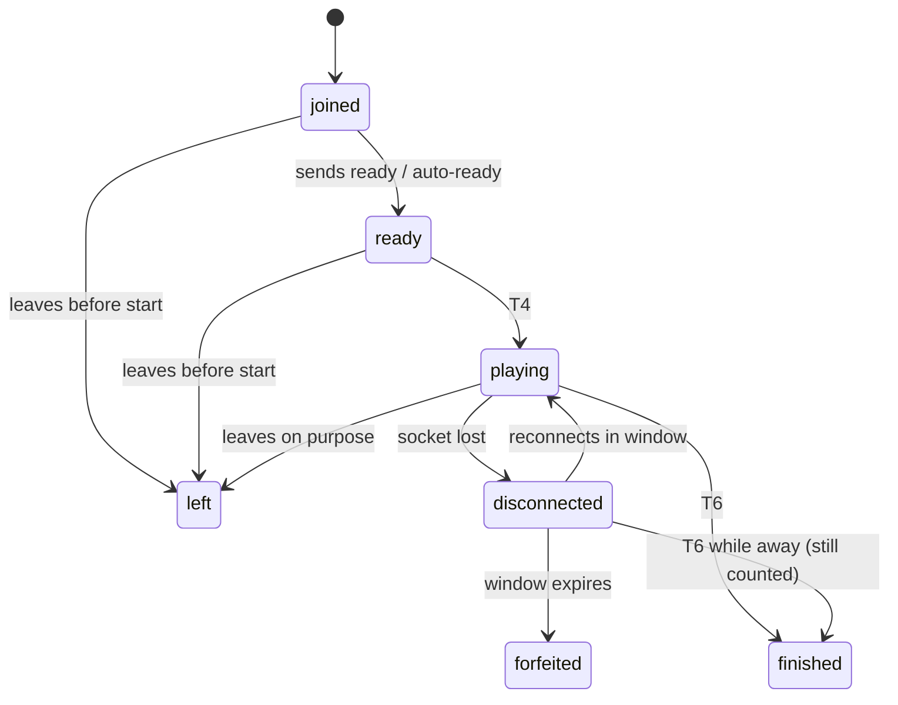

# Match lifecycle state machine

- **Roadmap task:** 0.3.1
- **Status:** Accepted (2026-10-15)
- **Owner module:** `game` (single writer per live match, `backend-modules.md` §3.4)
- **Related:** `schema-game.md` (columns `status`, `end_reason`, `cancel_reason`, participant `status`), `redis-keys.md` §2, round sub-machine 0.3.2, timing 0.3.3, disconnect/forfeit/tie rules 0.3.9, WS contract 0.4
- Values marked **(P)** were proposed and accepted (D-034, §9).

---

## 1. States

| State | Meaning | Terminal |
|---|---|:-:|
| `waiting` | Match exists; participants are assigned and must connect and confirm **ready** before the ready deadline. | |
| `ready` | Everyone is ready; a short **start countdown** runs; configuration and first questions are locked. | |
| `in_progress` | Rounds are being played (round sub-machine, 0.3.2). | |
| `completed` | Match ended normally or by forfeit; results are final and persisted. | ✓ |
| `cancelled` | Match ended without a result; **nothing** is awarded or deducted (no rating, SP, leaderboard points, quests, streak). | ✓ |

"Voided" is **not** a state: an admin can void a `completed` match later (`voided_at`, D-030); it stays `completed`.

No other transitions exist. A terminal state never changes again.

---

## 2. Transitions

### T1 — create → `waiting`
| | |
|---|---|
| **Trigger** | `game.CreateMatch(config, sides, origin)` called by `lobby` (room, challenge, rematch, revenge), `matchmaking` or `tournament`. |
| **Guards** (all must pass, else creation is rejected with an error code; nothing is written) | 1. Config valid against the mode matrix (0.5). 2. Side sizes match format; couple sides are couples (schema-game §2.1). 3. Every participant: `status = active`; no blocking sanction for this match type (`SanctionChecker`: `ranked_ban` for ranked, `matchmaking_ban` for matchmade origins, `suspension` always). 4. Every participant acquires `game:user:<id>:live` with `SET NX` — not already in a live match; on any failure all acquired locks are released. 5. Enough eligible questions exist for the config and all participant locales (content §3); fixed-length matches select **all** questions now, open-ended types select a first batch. 6. Ranked: a season is active. |
| **Effects** | Postgres (one transaction): `matches` (`waiting`), `match_sides`, `match_participants` (`joined`), `match_transitions` #1. Redis: `:state`, `:participants`, `:owner` lease (creating instance becomes owner), added to `game:live`. Realtime: `match.created` to each participant with `ready_deadline_at`. |

### T2 — `waiting` → `ready`
| | |
|---|---|
| **Trigger** | The last participant sends `match.ready` (client intent) **or** is auto-marked ready (see §4). |
| **Guards** | Every participant `status = ready`; current time ≤ `ready_deadline_at`. |
| **Effects** | `ready_at` set; Redis & Postgres status `ready`; `match_transitions`; realtime `match.starting` with `starts_at = now + countdown` (P: **3 s**). |

### T3 — `waiting` → `cancelled`
| Trigger | `cancel_reason` |
|---|---|
| Ready deadline passes and ≥1 participant not ready (P: deadline **20 s** after creation) | `not_all_ready` |
| A participant sends `match.leave` / declines | `participant_left_before_start` |
| Owner cannot continue (e.g. Redis loss, 0.3.9) | `server_error` |
| Admin action | `admin` |

**Effects:** Postgres `cancelled` + `cancel_reason`, `match_transitions`; outbox `game.MatchCancelled` (consumers: `matchmaking` re-queues participants who **were** ready **at the front of the queue** (priority placement, D-034); `lobby` returns the room to `open`; `tournament` applies no-show rules). Live locks released, Redis keys get the 1 h TTL. Realtime `match.cancelled {reason}`.
**No-show penalty (P):** a participant who misses the ready deadline in a **matchmade** match **3 times within 30 min** gets a **5 min** matchmaking cooldown (not a moderation sanction; stored in Redis `mm:` keys, Phase 5).

### T4 — `ready` → `in_progress`
| | |
|---|---|
| **Trigger** | Start countdown expires (server timer). |
| **Guards** | Still every participant connected or within reconnect allowance (0.3.9); owner lease held. |
| **Effects** | `started_at` set; participants → `playing`; Postgres status `in_progress` + transition; outbox `game.MatchStarted`; first round dispatched (0.3.2). |

### T5 — `ready` → `cancelled`
A participant leaves or disconnects without returning before the countdown ends (`participant_left_before_start`), or `server_error` / `admin`. Effects as T3. The short countdown means a disconnect here is treated as "not started", so nobody is penalised in rating.

### T6 — `in_progress` → `completed`
| Trigger | `end_reason` | Defined in |
|---|---|---|
| Last scheduled round revealed | `all_rounds_played` | 0.3.5 |
| Sudden Death decided | `sudden_death_decided` | 0.3.5 |
| Marathon time limit reached | `time_limit` | 0.3.5 |
| A side forfeits (no member returns within the reconnect window, or members leave) | `forfeit` | 0.3.9 |
| Every participant of one side has left voluntarily | `all_opponents_left` | 0.3.9 |

**Guards:** all revealed rounds persisted; score invariant holds (side score = sum of `round_results.points`).
**Effects (one Postgres transaction):** sides' `score`, `correct_count`, `result`; `winner_side_no` / `is_draw` (tie rules 0.3.9); participants → `finished` (or `left` / `forfeited`); `ended_at`, `end_reason`; `match_transitions`; outbox `game.MatchCompleted` with the full payload (schema-game §4); stats job for `content`. Then Redis: live locks released, keys TTL 1 h. Realtime `match.completed {results}`.

### T7 — `in_progress` → `cancelled`
| Trigger | `cancel_reason` |
|---|---|
| Owner lost and state cannot be recovered within the takeover limit (0.3.9) | `server_error` |
| Admin cancels a live match | `admin` |
| Integrity check fails during the match (e.g. question set corrupted, impossible state) | `integrity_violation` |
| No active participant on **either** side at the same moment (edge-cases.md §3) | `all_sides_absent` |

Effects as T3, plus already-persisted rounds stay (for audit and cheat analysis) but **count for nothing**.

---

## 3. Participant status (inside a match)

Leaving on purpose during `in_progress` is final for that participant (no rejoin); its effect on the side (forfeit or continue short-handed) is a 0.3.9 rule.

---

## 4. Ready flow per origin

| Origin | How participants become ready |
|---|---|
| `matchmaking` | Each player taps **Ready** ("Maç bulundu — Hazır mısın?") before the deadline. |
| `challenge`, `rematch`, `revenge` | Accepting the challenge is not enough (the challenger may have left): both sides tap Ready. |
| `private_room` | Players already readied in the room; the app **auto-sends** `match.ready` when the match screen opens. The deadline still applies (catches a closed app). |
| `tournament` | Ready window per round = `round_ready_window_s` (default 300 s, schema-platform §3); no-show = walkover. |
| *(Daily Challenge)* | Not a match: solo run with its own lifecycle (category-modes.md §5, D-040). |

---

## 5. Execution model (how transitions are applied safely)

1. **Single writer:** every command (client intent, timer expiry, admin call) for a match goes into the owner's per-match mailbox and is processed **one at a time**. No locks inside the match logic.
2. **Compare-and-set:** a transition is applied only if the current state equals its source state; anything else is ignored and logged (handles duplicate/late messages and racing timers).
3. **Write order:** non-terminal transitions update Redis and then Postgres `status` (small update, awaited). Terminal transitions commit **Postgres first** (results + outbox event in one transaction), then Redis. A crash between the two leaves Postgres authoritative; the sweeper (`game:live`) finishes the Redis cleanup.
4. **Timers** (ready deadline, countdown, round deadlines) use `platform/clock`; deadlines are absolute server timestamps stored in Redis, so a takeover owner re-arms them.
5. **Owner lease:** renewed every 3 s, expires after 10 s (redis-keys §2). Takeover and outage limits: 0.3.9.
6. **Every transition** writes `game.match_transitions` (`seq`, from, to, reason, actor) and pushes a sequenced event to `game:{m:<id>}:events` for reconnecting clients.

---

## 6. What each terminal state awards

| Effect | `completed` | `completed` + voided later | `cancelled` |
|---|:-:|:-:|:-:|
| Rating change (ranked) | ✓ | kept (D-030) | ✗ |
| SP / leaderboard points | ✓ (per 0.3.10) | revoked (D-030) | ✗ |
| XP | ✓ (per 0.3.10) | kept (P) | ✗ |
| Quest progress, play streak, Daily Challenge "counted" attempt | ✓ | kept (P) | ✗ |
| Question stats | ✓ | ✓ | ✗ |
| Match history entry | ✓ | ✓ (marked voided) | ✓ (marked cancelled) |

---

## 7. Invariants (asserted in code and tests)
1. `status` only moves along the arrows in §1.
2. `started_at` set ⇔ the match passed `ready → in_progress`.
3. A `completed` match has `ended_at`, `end_reason`, both sides' `result`, and exactly one of: `winner_side_no` or `is_draw = true`.
4. A `cancelled` match has `cancel_reason`, no `winner_side_no`, `is_draw = false`, and produced **no** `MatchCompleted`.
5. Each user holds at most one live match (`waiting`/`ready`/`in_progress`).
6. Exactly one of `MatchCompleted` / `MatchCancelled` is emitted per match, exactly once.

## 8. Key test cases (full catalogue in 0.3.11)
- All ready in time → starts; one missing at deadline → `cancelled/not_all_ready`, ready players re-queued.
- Two `ready` messages from the same user → second ignored.
- Ready arrives 1 ms after the deadline → rejected (deadline timer wins, CAS).
- Participant already in another live match → creation rejected, no rows written, no locks leaked.
- Leave during countdown → `cancelled/participant_left_before_start`, no rating change.
- Crash after Postgres commit of `completed` but before Redis cleanup → sweeper cleans; event emitted once.
- Duplicate `MatchCompleted` delivery to ranking → applied once (idempotency key).

---

## 9. Accepted proposals (D-034)
1. **Ready deadline 20 s** after creation (matchmaking, challenges, rooms); tournaments use their own window.
2. **Start countdown 3 s** after everyone is ready.
3. **No-show cooldown:** 3 missed ready checks in matchmade matches within 30 min → 5 min matchmaking cooldown (automatic queue-health measure, not a moderation sanction). Players who were ready return to the **front** of the queue.
4. **Voided matches revoke SP and leaderboard points only.** Non-cheating players keep XP, quest progress and streaks; cheaters are handled separately through account-level sanctions (no automatic XP revocation).
