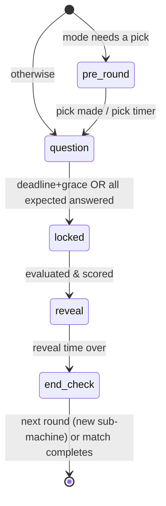
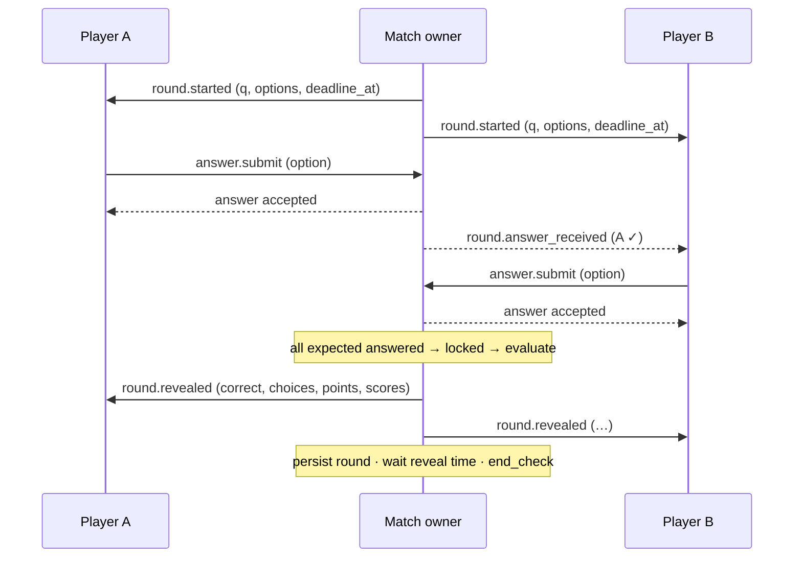

# Round sub-state machine

- **Roadmap task:** 0.3.2
- **Status:** Accepted (2026-10-15)
- **Owner module:** `game` — runs only while the match is `in_progress` (match-lifecycle.md)
- **Related:** timing & latency 0.3.3, scoring 0.3.4, match types 0.3.5, team answer mode details 0.3.6, category modes 0.3.7, disconnects 0.3.9, WS messages 0.4.4/0.4.5, Redis keys `redis-keys.md` §2
- Values marked **(P)** were proposed and accepted (D-035, §9).

---

## 1. Phases of one round

| Phase | What happens | Ends when |
|---|---|---|
| `pre_round` *(optional)* | Mode-specific step before the question, e.g. a side picks the next category (Mixed Battle). Skipped by modes that don't need it. | pick made or pick timer expires (default pick by server) |
| `question` | Server sends the question and the options **in this match's shuffled order**, with `deadline_at`. Expected answerers may submit. | `deadline_at + grace` reached **or** every expected answerer has answered (early lock) |
| `locked` | No more submissions accepted. Server evaluates answers, applies the side aggregation (team modes) and scoring. Instant — not visible as a wait. | evaluation done |
| `reveal` | Server publishes the correct option, every participant's choice, round points and running scores; **then** persists the round. Clients show the result. | reveal display time elapses (P: **3 s**) |
| `end_check` | Match-type rule decides: next round, or match ends (T6 in match-lifecycle). Instant. | decision made |

A round can also be **aborted** from any phase if the match leaves `in_progress` (forfeit, cancel — 0.3.9). An aborted, unrevealed round is never scored or persisted as a round.

---

## 2. Expected answerers per team answer mode

"Expected answerers" decides **who may submit** and **when early lock happens**.

| Mode | Who may submit this round | Early lock when … |
|---|---|---|
| 1v1 (no team mode) | both participants | both answered |
| **Shared Answer** (D-019) | every member may *propose*; **one locked side answer** per side | both sides have a locked side answer |
| **Individual Turns** (D-019) | per side, **only the member whose turn it is** (`answering_user_id`; rotation by `seat_no`, round 1 = seat 1, round 2 = seat 2, …, wrapping) | both turn-holders answered |
| **Fast Team Round** (D-019) | **every** participant on both sides, independently | all participants answered |

Disconnected expected answerers are still expected: early lock waits for the deadline (they may reconnect); a missing answer becomes a **timeout** (`option_id = NULL`, `is_correct = false`). What happens to a side whose turn-holder has *left* is a 0.3.9 rule.

---

## 3. Shared Answer mechanics (D-035; scoring details in 0.3.6)

1. During `question`, any member may send `answer.propose {option_id}`; teammates see each other's current proposals live (side-only event). Opponents see nothing.
2. Any member may send `answer.lock {option_id}` → that becomes the side's answer immediately (`is_side_answer = true`); response time = lock time.
3. If no one locked by `deadline_at + grace`: the side's answer is the **most-proposed option** (tie → the option proposed earliest); response time = the deadline. No proposals → side timeout.
4. Proposals are not stored as answers; only the side answer is written to `game.answers` (submitter = locker, or the first proposer of the chosen option).

---

## 4. Information visible during a round

| Phase | Own side sees | Opponent side sees |
|---|---|---|
| `pre_round` | the pick being made (by own side) | which side is picking, not the choice until made |
| `question` | prompt, options, deadline; own answer; **Shared Answer:** teammates' proposals; **Individual Turns:** who is answering; **Fast Team Round:** *that* teammates answered, not what (P) | *that* each opponent answered (✓), never *what* |
| `reveal` | everything: correct option, every participant's choice, response times, points, scores | same |

The **correct option is never sent before `reveal`** (server authority; `correct_option_id` lives only in Redis `:round` on the server).
**Blind Challenge:** category label hidden in `question`, shown in `reveal`; other modes show it in `question` (0.3.7).

---

## 5. What the server does at each step

| Step | Actions (all by the match owner, in its mailbox) |
|---|---|
| Start round | `round_no++`; take the next pre-selected question (or select the next one for open-ended modes); shuffle options (crypto-random); set `answering_user_id` (Individual Turns); write Redis `:round`; append event; send `round.started`; arm deadline timer. |
| Receive submission | Validate in order: round is `question` → sender is an expected answerer → option belongs to this question → first submission from this sender this round (`HSETNX`) → received ≤ `deadline_at + grace`. On pass: store, send `round.answer_received` (✓ only). On fail: reject with reason; increment `:rejects` (D-030 signal threshold). |
| Lock | Cancel deadline timer if early; freeze `:answers:<round>`; add timeout entries for missing expected answerers. |
| Evaluate | Correctness per answer; side result per team mode (0.3.6); points per 0.3.4; update `:scores`. |
| Reveal | Send `round.revealed` (correct option, choices, points, scores); **persist** `match_rounds`, `answers`, `round_results` in one transaction (schema-game §1); arm reveal timer. |
| End check | Ask the match-type rule (0.3.5): continue → start next round; finish → T6. |

If persisting a revealed round fails, the owner retries (idempotent on PKs); if it keeps failing the match is cancelled with `server_error` (T7) rather than continuing on unsaved data.

---

## 6. Sequence (1v1, early lock)

---

## 7. Invariants
1. Exactly one round is open per match at any time; `round_no` increases by 1 with no gaps.
2. No submission is accepted outside the `question` phase or after `deadline_at + grace`.
3. At most one accepted answer per participant per round; Shared Answer: exactly one side answer per side (or a side timeout).
4. Individual Turns: only `answering_user_id` of each side has an answer row (others' submissions rejected).
5. `correct_option_id` never appears in any client message before `round.revealed`.
6. Every revealed round is persisted before the next round starts.
7. Sum of a side's `round_results.points` = the side's running score.

## 8. Key test cases (→ 0.3.11)
- Both answer early → lock before deadline; one answers → lock at deadline + grace, other gets timeout.
- Submission 1 ms after deadline+grace → rejected `late`; at exactly the boundary → accepted.
- Duplicate submission → second rejected `duplicate`, first stands.
- Option id from another question → rejected `invalid_option`.
- Individual Turns: non-turn member submits → rejected `not_your_turn`; rotation wraps correctly for 3 seats over 7 rounds.
- Shared Answer: lock wins over later proposals; no lock → most-proposed option; tie → earliest; no proposals → timeout.
- Fast Team Round: opponents and teammates see only ✓ until reveal.
- Persist failure at reveal → retry, then cancel; no next round on unsaved data.
- Event stream contains every phase change in order (resume support).

---

## 9. Accepted proposals (D-035)
1. **Reveal display time 3 s** before the next round (or the results screen).
2. **Early lock:** a round closes as soon as every expected answerer has answered.
3. **Shared Answer:** teammates propose live; any member can lock the side answer; no lock by the deadline → most-proposed option (tie → earliest); no proposals → timeout.
4. **Fast Team Round:** teammates see only *that* a teammate answered, not *what*, until reveal (keeps answers independent).
5. **Individual Turns rotation** by seat order (1, 2, 3 … wrapping), same rotation on both sides.
